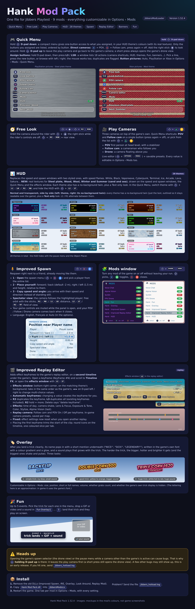

# Hank Mod Pack

Nine mods for [JibbersModLoader](https://github.com/jaxoncarelos/JibbersModLoader) (Jibbers Playtest), built into a single DLL: `Hank Mod Pack.dll`. Gamepad first, everything customizable from **Options > Mods**.



> **Early release (1.52.x).** A few bugs can still show up. Opening the game's spawn selector (the drone view) or the pause menu while a camera other than the game's is active can misbehave: **hold D-pad up** first to go back to the game's camera. If something breaks, send `jibbers_hotload.log`.

In Options > Mods you get one entry per mod, all named `Hank Mod Pack: ...`, each with its own Enabled switch and its own settings (every button, size, theme, camera value and effect).

| Mod | Source folder | What it does |
| --- | --- | --- |
| **Quick Menu** | `LookAround/`, `QuickMenu/` | Hold D-pad down: a compact menu lists the actions you assigned, one button each (direct camera shortcuts included). Button pictures for PlayStation or Xbox. |
| **Free Look** | `LookAround/` | Orbit the camera around the rider with the right stick, rear view with R3. |
| **Play Cameras** | `PlayCameras/` | POV, Follow cam and Drone cameras while riding, with a live editor and savable presets. |
| **HUD** | `Hud/` | Replaces the game's speed and spawn windows with two windows in 28 themes (each with a no-background twin, plus a Text only theme), with speed flames. |
| **Improved Spawn** | `ImprovedSpawn/` | Spawn next to an online player with their speed and direction. Spectator camera and free spectator view. |
| **Improved Replay Editor** | `ImprovedReplayEditor/` | Effect keyframes on a second timeline: time of day, camera shake, image effects. Presets per map. |
| **Replay Camera** | `ImprovedReplayEditor/` | Follow cam and POV in the replay (same engine as Play Cameras). |
| **Overlay** | `Overlay/` | Trick banners in the game's font, with a sound that grows with the trick. |
| **Fun** | `Overlay/` | Up to 5 events: a trick plays a GIF or video and a sound. |

## Install
1. Delete the old `Improved Spawn.dll`, `IRE.dll`, `Overlay.dll`, `Hank Look Around.dll` and `Hank Replay Mod.dll` from `<game folder>\JibbersMods\cs\` (otherwise the mods load twice).
2. Copy `Hank Mod Pack.dll` into `<game folder>\JibbersMods\cs\`.
3. Restart the game completely (a hot reload can keep the old DLL).

The first launch creates `JibbersMods\Hank Mod Pack\` and imports the settings saved by earlier versions (Look Around settings are imported into Free Look). Each mod writes its own prefix in `jibbers_hotload.log`: `free_look:`, `quick_menu`, `play camera:`, `replay camera:`, `hank_hud:`, `join_spawn:`, `TLFX:`...

## Gamepad shortcuts
Everything starts from **D-pad down** held (PlayStation / Xbox names):

| Button (default) | Action |
| --- | --- |
| Right stick | Free look |
| R3 / RSB | Look behind (rear view) |
| Cross / A | POV camera (press again = off) |
| Circle / B | Follow cam (press again = off) |
| Triangle / Y | Camera list: Cross / A = POV, Square / X = Follow cam, Triangle / Y = Drone, Circle / B = the game's camera |
| Square / X | Spawn menu |
| Options (Start) / Menu | Camera editor |
| Share / View | Mods window |
| L2 / LT | HUD on / off |
| L1 / LB, R1 / RB | Previous / next HUD theme |

- **Hold D-pad up** (about 0.6 s) leaves the play camera and goes back to the game's camera, without opening the game's drone view. A short press always opens the game's drone view (spawn selector).
- The pause menu (Start) steps the chosen camera aside, then it comes back.
- Moving the right stick hides the Quick Menu until you stop. The row you pick lights up for a moment.
- **D-pad down + L3** opens the **button assignment window**: pick an action, then press the new button (or left / right to browse, or click with the mouse).
- Every action has its own button choice (or None) in Options > Mods > Quick Menu > Buttons. **Button pictures**: Auto, PlayStation or Xbox.
- Keyboard: no mod uses an F key by default any more; each mod keeps its key options (for example Improved Spawn opens with Insert).

## Quick Menu
Compact menu in the colours (and the real texture) of the chosen HUD theme. Only the actions that have a button assigned are listed, ordered by button (right stick and R3 first, then the face buttons, the other buttons, and L1 / R1 for the themes last), with the current theme at the bottom. Size, opacity and the time it stays on screen after a choice are options.

**Mods window** (D-pad down + Share / View): lists every mod loaded in the game with an ON / OFF badge. D-pad up/down picks, A (or left/right) toggles, B or Start closes. The game's controls are muted meanwhile. Quick Menu and Free Look cannot be switched off from here (the window would not open again).

## Free Look
D-pad down + right stick turns the camera around the rider, with the rider's controls off (option) and the stance kept. R3 gives a rear view. L1 / R1 zoom (unless they are used for the HUD themes). Options: hold time, look speed, invert axes, rear view swing speed and height.

## Play Cameras
Three cameras on top of the game's own, chosen in the Quick Menu or in the editor. They step aside by themselves when the game needs its camera (pause menu, spawn menu, free look).
- **POV**: first person at head level. *View based on* Head, Shoulders, Torso or Spine only decides where the view turns, the camera always stays at head level. FOV, eye height and offset, look up/down, horizon height, smoothing, **Stabilizer %** (gimbal-like: smoothing with a short lag, level horizon, less shake), head shake, FOV boost with speed, hide the head and helmet.
- **Follow cam**: a cameraman films the rider: angle, distance, height, aim, reactivity, lead, speed pull-back, shake and "relief" (banking in turns, wider with speed).
- **Drone**: floats above: distance, altitude, angle, reactivity, orbit, hover drift, bank in turns, FOV with speed.
- **Camera editor** (D-pad down + Options): one tab per camera, values change live. L1 / R1 switch camera, D-pad up/down picks a row, left/right changes the value (hold = faster), A toggles, Y resets, B or Start closes. Presets (choose, save, save as new, rename with the keyboard, delete) are stored in `Camera Presets.json`.

## HUD
Replaces the game's spawnpoint / stance / respawn speed window and the speed window with two windows in 28 themes (each with a no-background twin, plus a Text only theme): White, Black, Vaporwave, Cyberpunk, Terminal, Ice, Arcade, Rounded, Hip Hop, Freestyle, Graffiti, Sunset, Ocean, Lava, Forest, Candy, Gold, Midnight, Sakura, Toxic, Steel plate, Wood, Wool, Winter, Summer, X Games, SLVSH, Skis. Steel plate, Wood, Wool, Winter and Summer use real textures (`Hud/Tex/*.bin`, generated by an offline script; 560x300 tiles). Speed flames in the colours of the theme (*Flames start at*), HUD size, show/hide. It hides with the pause menu and the Object Placer window, and D-pad down + L2 hides it completely. The Quick Menu, the Mods window and the spawn menu use the same theme.

## Improved Spawn
- Open the list from the Quick Menu (D-pad down + Square / X), or with Insert (changeable).
- Choose a player, then adjust forward/back, right/left and height (defaults: -2, 1.5, 0.1). "Copy their speed and angle" makes you arrive with their speed and direction.
- The spectator camera follows the highlighted player while the list is open. **Spectator view** is a free orbit camera: sticks turn, R1/L1 move closer/away, L2/R2 change the FOV. Your POV / Follow / Drone camera steps aside and comes back when the menu closes.
- While the panel is open, the game's gamepad and keyboard controls are muted and restored when it closes.
- The panel takes the HUD theme. English or French (Language option).

## Improved Replay Editor
- Open a keyframe in the replay (**Keyframe #N** panel) and scroll to **Timeline FX: effect keyframes**. Every tab has a coloured dot matching its icon on the timeline, and these buttons: **Add Keyframe**, **Copy | Paste**, **Duplicate | Delete**, **Reset values**.
  - **Time of day**: time, **Sun direction**, **Sun height**, **Moon phase**.
  - **Camera Shake**: strength, speed, smoothness, rotation / position / roll. Slow, hand-held movement.
  - **Lens & Focus**, **Exposure & Tone**, **Color**, **Blur**, **Stylize**: the sliders of the game's Camera Effects menu.
  - **Follow cam** and **POV** tabs: the replay camera, switched On / Off per keyframe (see Replay Camera below).
- An **effects window** (L2 with a keyframe panel open, Circle closes it, hold R2 for "more" = bigger steps; side choosable in Options) lists every effect at the playhead, one tab per group in the same order as the game's panel (L1 / R1), on the background of the current HUD theme. D-pad or mouse: choose, change (D-pad left / right on choices, click or drag on a bar), A next choice, Y delete keyframe, X add keyframe, **R3 duplicate**, **L3 duplicate all** (existing keyframes included). Changing a value creates the effect keyframe automatically. The POV tab has the **Learn the body axes** button. Effect settings are reset when another replay opens.
- Placing the first keyframe automatically trims the start of the clip to that point.
- A second timeline under the game's shows the effect keyframes: one round icon per keyframe, split into one coloured slice per tab used, white outline when the playhead is on it. It is only a marker (not clickable) and follows the game's bar, including trimmed clips.
- Like the game's keyframes, an effect keyframe starts acting at its frame: nothing happens before the first one, values blend between two keyframes, and the last keyframe's values hold until the end.
- **CamLight** switch: a light on the replay camera. If the **Alpine Vision** mod is installed, an **Alpine Vision (live)** tab shows its settings.
- Copy / Paste work on the keyframe under the playhead, or on the values in effect if there is none. Duplicate copies a tab to the next game keyframe.
- **Save / Load / Delete keyframes**: Save asks what to save (Game, FX or Both) and a name. Presets go to `Hank Mod Pack\Replay Editor Keyframes\Presets\<map name>\`; positions are stored as a fraction of the clip, so a preset fits a longer or shorter replay. Quick save / delete keys are options.

## Replay Camera
Follow cam and POV in the replay editor, chosen per keyframe (On / Off) or, with no camera keyframe, by the *Replay camera* setting. A replay opened while POV, Follow cam or Drone is active starts with that camera and its exact in-game settings (presets *In-game camera* / *In-game drone*), so one keyframe (or none) is enough. FOV uses the game's own replay editor slider. The keyed Time Scale of the game's keyframes is applied by the mod while one of its cameras is active (it changes the game clock only, so it is not in the video export yet: see Known limits). The body axes of the character are learned once and kept; the **Learn the body axes** button forces a new learning.

## Overlay
Trick banners shown after a clean landing: the trick name in the game's font with a colour gradient and a glow (icy blue for a simple trick, yellow-orange for a good one, white-hot to red for a huge one), a short mention under it (NICE!, SICK!, LEGENDARY!...), and a sound that grows with the trick. Options: size, position, short or full names, ignore grabs, wait time after landing, volume, hide the game's own trick display.

## Fun
- Pick the trick of each event in Options > Mods; put its GIF/video and sound in `Fun Overlay\1` ... `5`. An event with an empty folder shows nothing.
- Ready to use (files are copied the first time, only into empty folders):

| Event | Trick | Media |
| --- | --- | --- |
| 1 | Backflip (and switch backflip) | Rick Astley GIF + "Never Gonna Give You Up" |
| 2 | Rotation of 1620 or more | Helicopter GIF + "Helicopter Helicopter" |
| 3 | Any triple (triple cork, triple backflip...) | Pikachu GIF + "OH BABY A TRIPLE" |
| 4 | Misty (all counts) | your files |
| 5 | Bio (all counts) | your files |

- If your saved settings still hold older tricks for events 2 and 3, change "Event 2: trick" and "Event 3: trick" by hand.
- Advanced events (several tricks, regex) can go in `Fun Overlay\events.json`. See `Overlay/README.md` for the details.

## Folders

```
JibbersMods\Hank Mod Pack\
  README.md                 short guide, created automatically
  Camera Presets.json       Play Cameras presets
  Overlay Files\            Overlay: one folder per overlay, known_tricks.txt
    Overlay Sounds\         banner sounds (created automatically)
  Fun Overlay\              Fun: events.json
    1\ ... 5\               the GIF/video + sound of Fun event 1 ... 5
  Replay Editor Keyframes\  Improved Replay Editor: effect keyframes of each clip
    Presets\<map>\          saved keyframe presets, one folder per map
```

## Build
Requirements: .NET 8 SDK and the game with the modloader installed (the project references `Jibbers.Sdk.dll` from the game folder; it is not part of this repository).

    dotnet build -c Release

The DLL is copied to `<game>\JibbersMods\cs\` if the game is found. Another game folder, or another SDK path:

    dotnet build -c Release -p:JibbersGame="D:\Games\Jibbers Playtest"
    dotnet build -c Release -p:JibbersSdk="D:\path\to\Jibbers.Sdk.dll"

On Windows, `build.bat` does the same and can install the .NET 8 SDK with winget. Close the game before building (it locks the DLL).

## Known limits
- Replay: the keyed Time Scale is not part of the video export when a mod camera (POV / Follow cam / Drone) is used. Version 1.52.8 logs `TS probe` lines to learn how the game stores it.
- Mockups and previews are drawn with the mod's colours, not captured from the game.
- Image effects are written to the game's Camera Effects menu; the mod pauses them while that menu is opening.
- The sun and moon options depend on the game honouring those values each frame.
- Another mod that reacts to the time of day (for example a night-lighting mod) is triggered each time a time-of-day keyframe crosses its threshold.
- The game's spawn selector and pause menu need the game's camera: hold D-pad up to reset it first.
- The game's replay editor cannot be opened from the mod (no API found).
- D-pad down + L3 opens the button assignment window.

## Credits
Overlay uses NLayer (MIT, `Overlay/NLayer/LICENSE.txt`) to decode mp3.

## Repository layout

```
Hank Mod Pack.csproj   single project, one DLL
HankModPack.cs         pack entry point
Hud/                   HUD windows, themes, textures (Tex/*.bin embedded)
LookAround/            Quick Menu logic, Free Look, key assignment window, Mods window, camera editor
QuickMenu/             Quick Menu overlay, button pictures, mouse pointer
PlayCameras/           POV / Follow cam / Drone while riding
ImprovedSpawn/         spawn next to a player, spectator view
ImprovedReplayEditor/  effect keyframes, effects window, replay camera
Overlay/               trick banners and Fun events (NLayer mp3 decoder included)
docs/                  overview picture, store texts, history
build.bat, find-sdk.ps1 Windows build helpers
```

See [CHANGELOG.md](CHANGELOG.md) for the changes of each version. Licensed under the MIT license (see `LICENSE`).
